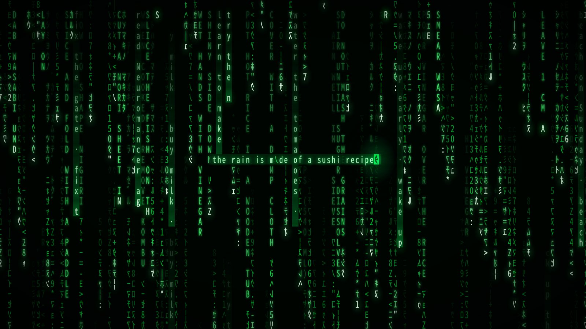
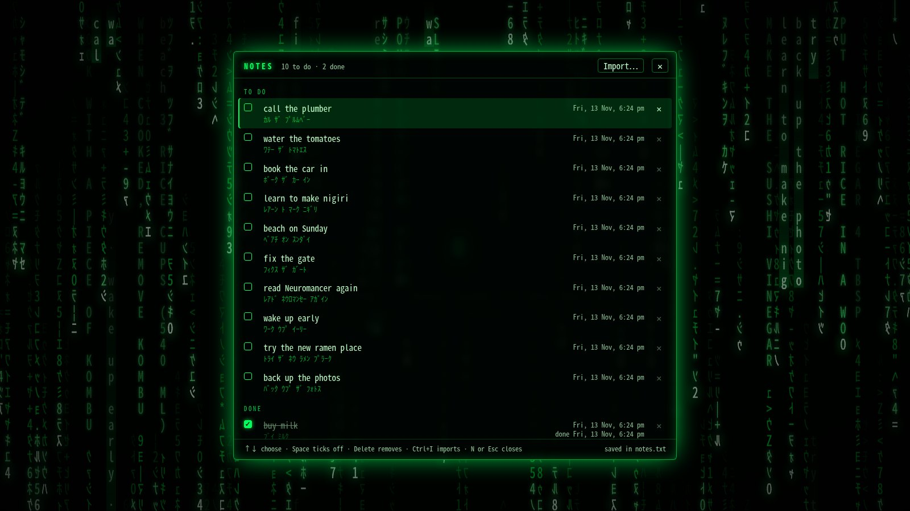
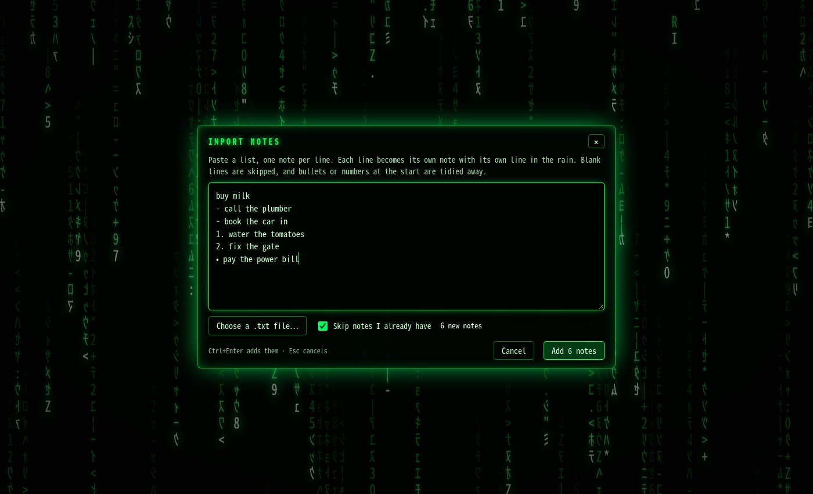
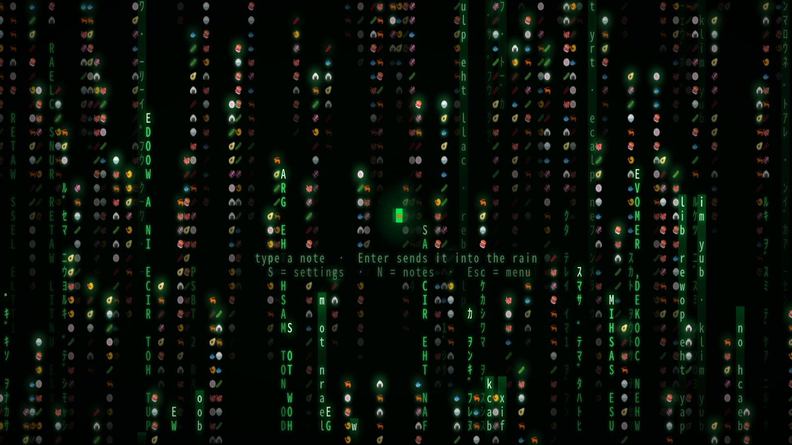

<div align="center">


# Sushi Rain <sub>for Windows</sub>

**A note-taking toy that lives inside the Matrix rain.**

Type in the middle of a living wall of falling code. Press Enter and your words
fly up, becoming their own stream in the rain — and stay there.

[](#quick-start)
[](#quick-start)
[](#how-its-built)
[](#how-its-built)
[](#private-by-design)

[Quick start](#quick-start) · [Keys](#keys) · [Notes](#notes-a-file-you-own) · [Plugin API](#plugin-api)

</div>

---



## Why you'll want it

- **Notes that rain.** Every note you send gets its own column of falling code and keeps
  falling there. No two notes share a line until every line is taken.
- **Code you can read through.** What you type sits in a lit band; the rain keeps falling
  through it, flickering letters into glyphs for a moment while the words stay legible.
- **A real sushi recipe, falling quietly.** The Matrix rain was made from a Japanese
  cookbook, so here one is, hidden in the columns. Press `F4` to read it in katakana or English.
- **Sushi mode.** Notes can be sounded out into half-width katakana, the film's own alphabet:
  `buy milk` → ﾌﾞｲ ﾐﾙｸ. Press `F8` to switch.
- **Made to look at.** Five colour themes, three alphabets (katakana, binary, hex), actual
  🍣 rain, trails that lengthen, rain that falls *up*, and disco colours.
- **Quietly tactile.** Optional synthesised key clicks and a soft rain bed, generated live —
  no audio files, no downloads.
- **Yours alone.** One plain-text file, one local server, no account and no cloud.

| The notes list | Import a whole list | Sushi mode, falling up |
|:---:|:---:|:---:|
|  |  |  |

## Quick start

> **You need:** Windows 10/11, [Python 3](https://www.python.org/downloads/windows/) and a browser.
> During the Python install, tick **Add python.exe to PATH**.

1. **Double-click `run.cmd`** — it starts the local server and opens the page.
2. Or, from a Command Prompt in this folder:

   ```bat
   py -3 server.py
   ```

3. Open **<http://127.0.0.1:8777/>**, type, and press **Enter**.

That's it. The server listens only on your own computer and keeps every note in
`notes.txt` next to these files. Close the server window (or press `Ctrl+C`) to stop it.

**Prefer no server?** Double-click `index.html`. Everything works; notes are then kept in
the browser instead of `notes.txt`.

## Keys

| Key | What it does |
| --- | --- |
| Type | Writes, centred on screen |
| **Enter** | Sends what you typed into the rain as a note |
| `Shift+Enter` | New line inside a note |
| **N** (nothing typed) or `Alt+N` | Notes list: `Space`/`Enter` ticks off, `Delete` twice removes, `Ctrl+I` imports |
| **S** (nothing typed) or `Alt+S` | Quick settings: `↑↓` choose, `←→` change |
| `F8` | Note script: English → sushi → both |
| `Esc` / `F1` | The menu: settings, save/open, import, keys |
| `F2` | Sound on/off |
| `F4` | The sushi recipe in the rain: Japanese → English → both → off |
| `Ctrl+S` / `Ctrl+O` | Save the page as a `.txt` / open a `.txt` |
| `Ctrl+Z`, arrows, `Home`/`End`, `Ctrl+A/C/X/V` | Undo, move, select, clipboard |
| Type `sushi` | 🍣 |

The empty page stays clean: press a key that types nothing (Enter, an arrow, Backspace) and a
short reminder appears for five seconds. `N` and `S` only open when nothing is typed — keep
typing and they close again, with your letters (the N or S included) going onto the page.

## Notes: a file you own

`notes.txt` holds one note per line, and you can edit it in Notepad while the app is open —
changes appear within a few seconds.

```text
[ ] 2026-11-13 17:42:05  buy milk
[x] 2026-11-13 17:45:31  call the plumber  (done 2026-11-13 18:02:10)
```

`[ ]` still rains, `[x]` is ticked off. A line typed without the `[ ]` part becomes a new note.
Each note's column is remembered in `.notes-lines.json`.

**Import** (N list → *Import…*, or Esc → *Your notes*): paste a list or pick a `.txt` file. Blank
lines are skipped, bullets and numbers at the start (`- `, `* `, `• `, `1. `) are tidied away,
lines in `notes.txt`'s own format keep their tick, and notes you already have can be skipped.

## Make it yours

Everything in the menus is saved in the browser. For a single visit you can override any of it
in the address, e.g. `?theme=amber&glitch=0.8&glyphSet=binary&reverse=1` (never saved). Also:

- `fresh=1` — start empty, save nothing
- `demo=Hello%5Cnworld` — type that by itself (`cps=20` sets the speed)
- `menu=1` — open the menu at start

## Private by design

- The server binds to **127.0.0.1** only — nothing is reachable from the network.
- No accounts, no telemetry, no analytics, no CDN. The page makes no outside requests.
- Fonts fall back to what Windows has; there is nothing to install.
- Your notes are a plain text file you can copy, back up or delete yourself.

## How it's built

Plain HTML, CSS and JavaScript — no framework, no bundler, no build step — drawn on a single
canvas character grid so the rain columns line up exactly with the letters you type. A small
Python standard-library server serves the files and reads/writes `notes.txt`.

| File | What it does |
| --- | --- |
| `index.html` | The page |
| `core.js` | Rain engine, editor (a hidden textarea, so undo, clipboard and IME work), flickering text, cursor, settings, plugin API |
| `quick.js` | The S quick-settings strip |
| `notelist.js` | The N notes list |
| `importer.js` | Import notes from a list |
| `notes.js` | Notes: Enter → a column in the rain, storage (`notes.txt` or the browser), English → sushi |
| `recipe.js` | The sushi recipe raining down some columns (half-width katakana and English) |
| `sound.js` | Synthesised sounds (Web Audio, no audio files) |
| `panel.js` | The Esc menu |
| `server.py` | Serves the app on 127.0.0.1:8777 and keeps `notes.txt` (Python 3 standard library only) |
| `run.cmd` | Windows launcher: starts the server and opens the page |

## Plugin API

<details>
<summary><strong>Show the plugin API</strong> — hooks, settings and drawing for custom rain</summary>

Plugins are plain `<script>` files loaded after `core.js` and before `SR.start()`, and talk to the
core only through `window.SR`.

**Hooks** (`SR.on(name, fn)`):

| Hook | Called with | Notes |
| --- | --- | --- |
| `frame` | `(dt, now)` | Every frame before drawing. Seconds. |
| `drawBack` | `(ctx, grid)` | After the background clear, before the rain |
| `drawOver` | `(ctx, grid)` | After rain, text and cursor |
| `key` | `(KeyboardEvent)` | Window keydown, capture phase, before the editor. Return `true` to consume it. Only consume your own keys. |
| `type` | `({index, text})` | After text was inserted (typing, paste, undo) |
| `erase` | `({index, count, text})` | After text was removed |
| `dropText` | `(col)` | A new drop starts at the top of column `col`. Return a string or `{text, speed, len, style, tag}` to make it write that text down the column. First non-null answer wins, so load order matters. |
| `settings` | `(settings, changedKey)` | After `SR.setSetting` (key is null after a reset) |
| `resize` | `(grid)` | After the grid was rebuilt |

**Settings:** `SR.settings` (live), `SR.DEFAULTS`, `SR.setSetting(key, value)`, `SR.resetSettings()`,
`SR.addSetting(key, default, control?)`. `SR.controls` is what the menu renders:
`{key, label, type: 'range'|'toggle'|'select', group, min, max, step, options, format, unit}`.
`SR.THEMES` and `SR.theme()`; the CSS variables `--sr-rain --sr-head --sr-text --sr-hl --sr-bg --sr-font`
follow the theme. `SR.GLYPH_SETS` holds what the rain can be made of.

**Drawing:** `SR.grid` `{dpr, W, H, fontPx, cw, ch, cols, rows, ox, oy}` (device pixels), `SR.cellX(col)`,
`SR.cellY(row)`, `SR.drawGlyph(char, style, col, row, alpha)`, `SR.addStyle(name, {color, glow, mirror, glowColor})`,
`SR.randGlyph()`, `SR.noiseGlyph(seed, now, rate)`. The rain: `SR.rain.spawn({col, y, speed, len, text, style, tag, stopAt})`,
`SR.rain.advance(drop, y)`, `SR.rain.cellLight(col, row)` (0 = a drop head is here, -1 = dark),
`SR.rain.cellGlyph(col, row)`, `SR.rain.screenRow(r)`. `SR.layout` is the last frame's text layout.

**Text and UI:** `SR.getText()`, `SR.setText(str)` (undoable), `SR.insertText(str)`, `SR.autoType(str, cps)`,
`SR.saveFile()`, `SR.openFile()`, `SR.toast(msg, ms)`, `SR.hints` (lines under an empty page),
`SR.panelSections.push({id, title, render(el, {close, refresh})})` (a section in the Esc menu),
`SR.modal` (set while your own panel has the keyboard), `SR.focusInput()`, `SR.store` (localStorage, safely).

**From the plugins:** `SR.notes` `{list, add, importLines, setDone, remove, clear, status, onChange, toSushi, when}`,
`SR.noteList`, `SR.importNotes`, `SR.quick`, `SR.panel` `{open, close, isOpen}`, `SR.recipe` `{cycle, cascade}`,
`SR.sound` `{play(name)}`.

</details>

## About the rain

Simon Whiteley, who designed the falling code for *The Matrix*, has said he made it from
characters scanned out of his wife's Japanese cookbooks — sushi recipes included. Sushi Rain is
a fan-made homage, not affiliated with the film. All of its code, sounds and the rain itself
are original.

<div align="center">
<br>

**Sushi Rain for Windows** — the web app on its own, without the Linux screensaver.

<sub>Made for slow evenings, fast typists and anyone who ever wanted to type inside the rain.</sub>

</div>
